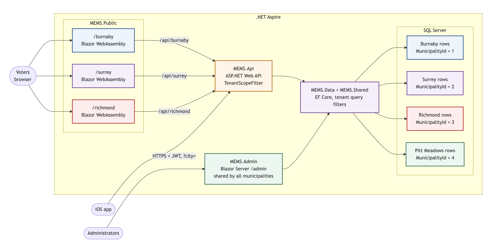

# Municipal Elections Management System (MEMS) - Assignment 2

BCIT COMP4976 / COMP4977, Assignment 2 (due Fri Nov 20, 2026, 11:59 pm). Team: Minsu Kim (A01424659), Justice Plunkett (A01405284).

MEMS is a multi-tenant application. Every municipality is a tenant with its own public site (`/burnaby`, `/surrey`, `/richmond`, `/pitt-meadows`), its own candidates and its own administrators. One shared administration site (`/admin`) manages all of them, and one Web API serves the public site and the iOS app. Everything is orchestrated with .NET Aspire.



## Solution (`MEMS.sln`)

| Project | What it is |
|---|---|
| `src/MEMS.AppHost` | .NET Aspire AppHost: SQL Server container, Api, Admin, Public, service discovery, connection strings, dashboard |
| `src/MEMS.ServiceDefaults` | Logging, tracing, health checks, service discovery |
| `src/MEMS.Shared` | DTOs and request classes with validation, roles, limits, shared rules |
| `src/MEMS.Data` | EF Core Code First, migrations, seed data, tenant-aware services |
| `src/MEMS.Api` | ASP.NET Web API (JWT, tenant isolation, Swagger) |
| `src/MEMS.Admin` | Blazor Server administration site (`/admin`, ASP.NET Core Identity) |
| `src/MEMS.Public` | Blazor WebAssembly public site (one app, tenant from the URL) |
| `tests/MEMS.Tests` | xUnit tests |
| `ios/` | SwiftUI app "Municipal Elections Companion" (COMP4977) |
| `docs/` | API documentation, ERD, architecture diagram |

## Run it

Requirements: .NET 10 SDK (`global.json`), Docker Desktop (running), and optionally the Aspire CLI.

```bash
dotnet run --project src/MEMS.AppHost      # or: aspire run
```

The first start pulls the SQL Server 2022 image. The Api creates the database, applies the migration and loads the seed data. The AppHost passes the connection string (`memsdb`) and a development-only JWT key; nothing has to be configured by hand. Uploaded photos and logos go to the git-ignored `uploads/` folder.

| What | Address |
|---|---|
| Aspire dashboard | https://localhost:17228 (the exact link, with login token, is printed in the terminal) |
| Public site | https://localhost:7025 (tenants: `/burnaby`, `/surrey`, `/richmond`, `/pitt-meadows`) |
| Admin site | https://localhost:7036/admin |
| Web API and Swagger UI | https://localhost:7261/swagger |

The public site reads the Api address from `src/MEMS.Public/wwwroot/appsettings.json` (a browser app cannot use the server-side service discovery); it matches the fixed Api port in `launchSettings.json`.

## Test accounts (password for all: `P@$$w0rd`)

| User | Role | Tenant |
|---|---|---|
| `super` | Super Admin | all municipalities |
| `burnabyadmin` | Municipality Admin | Burnaby |
| `surreyadmin` | Municipality Admin | Surrey |
| `richmondadmin` | Municipality Admin | Richmond |
| `pm` | Municipality Admin | Pitt Meadows |

Seed data: 4 municipalities, 12 positions (Mayor, Councillor, School Trustee), 25 fictional candidates. People who register in the iOS app are normal users without a role and cannot log in to the admin site.

## Tests

```bash
dotnet test tests/MEMS.Tests               # 44 tests, no Docker needed (in-memory database)
```

Besides these, the API, the admin site and the public site were checked end to end (curl and a headless browser) with the Aspire stack running; see the project document.

## Documentation

- [docs/api.md](docs/api.md): endpoints, request and response examples, error responses
- [docs/erd.png](docs/erd.png), [docs/architecture.png](docs/architecture.png), [docs/ios-architecture.png](docs/ios-architecture.png): diagrams (Mermaid sources: `docs/*.mmd`)
- [docs/deficiency-report.md](docs/deficiency-report.md): how the Assignment 1 findings were fixed
- `.github/`: `copilot-instructions.md`, prompts and skills for the AI assistants (GitHub Copilot, Claude Code), and the Azure deployment workflow

## Branches and deployment

Work is done on a personal branch, merged into `dev2` (`dev` still holds Assignment 1), and `dev2` into `main`. A push to `main` that changes `src/` redeploys only the Web API (`MEMS.Api`) to Azure App Service (`.github/workflows`); the Blazor Admin and Public sites run locally with Aspire.

The deployed Api is used by the iOS app. To save Azure credits (as advised by the instructor) it stores its data in a **SQLite file** instead of SQL Server (the Api supports both; the Aspire setup for the .NET assignment uses SQL Server). The App Service needs these settings:

| Setting | Value |
|---|---|
| `Database__Provider` | `Sqlite` |
| `ConnectionStrings__memsdb` | `Data Source=/home/data/mems.db` |
| `Jwt__Key` | a random string of at least 32 characters |
| `Uploads__Path` | `/home/data/uploads` |
| Startup command | `dotnet MEMS.Api.dll` |

The database file is created and seeded when the Api starts.

## Submission

The same repository is submitted for COMP4976 and COMP4977. The iOS project must not be in the COMP4976 (.NET) zip.

```bash
git archive --format=zip --prefix=MEMS/ -o MEMS-COMP4976.zip main -- . ':(exclude)ios'
git archive --format=zip --prefix=MEMS/ -o MEMS-COMP4977.zip main
```
