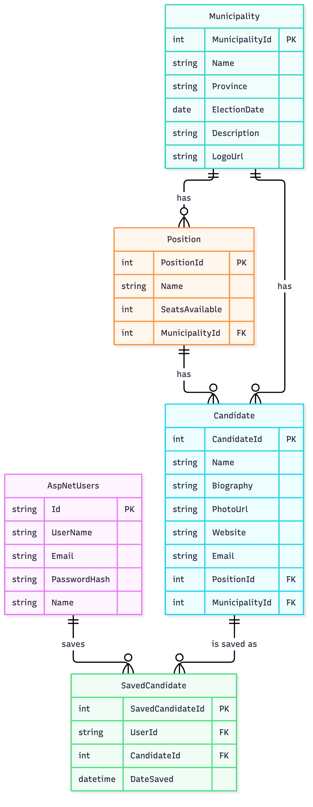
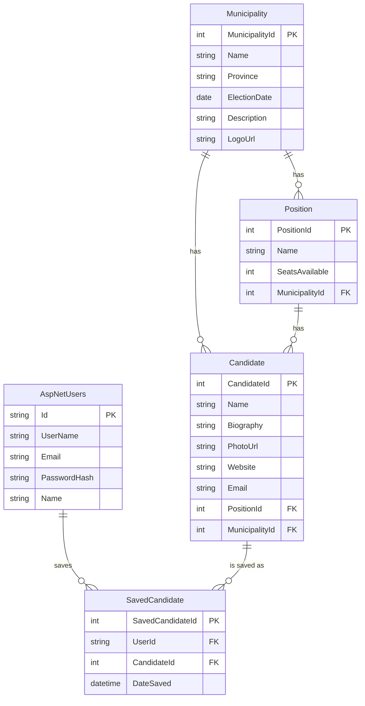
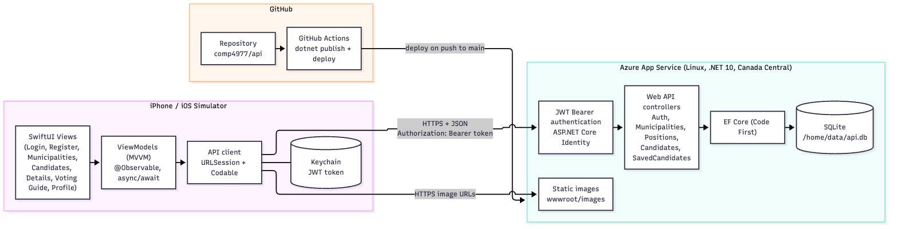
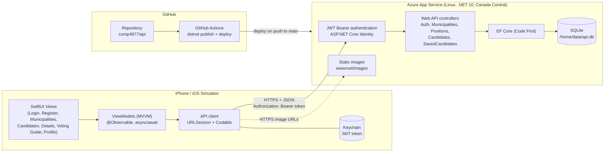

# COMP4977 - Diagrams

Both diagrams are Mermaid (`erd.mmd`, `architecture.mmd`); the PNG files are the exported
images for the project document. GitHub renders the blocks below directly.

## Database ERD

Relationships and constraints:
- A municipality has many positions and many candidates; a position has many candidates.
- Deleting a position deletes its candidates (cascade). `Candidate.MunicipalityId` is
  restricted (no second cascade path) and always matches the municipality of the position.
- `SavedCandidate` links a user to a candidate (the voting guide). Deleting the user or the
  candidate removes the saved rows. `(UserId, CandidateId)` is unique, so a candidate can be
  saved only once per user.
- `AspNetUsers` is the ASP.NET Core Identity user table (extended with `Name`); the other
  Identity tables (roles, claims, logins, tokens) are created by the Identity migration.
- Database table names are plural (`Municipalities`, `Positions`, `Candidates`,
  `SavedCandidates`); the diagram uses the entity names from the assignment.

## Architecture

The iOS app (left) calls the REST API over HTTPS. Login returns a JWT that the app keeps in
the Keychain and sends as a Bearer token for the voting-guide endpoints. The API
(right) reads and writes SQLite through EF Core and serves the candidate and logo images.
Pushes to `main` that change `comp4977/api` are built and deployed by GitHub Actions.

Re-export the PNGs after editing a `.mmd` file (needs Node and Chrome):
`npx @mermaid-js/mermaid-cli -i erd.mmd -o erd.png -s 2 -b white`
