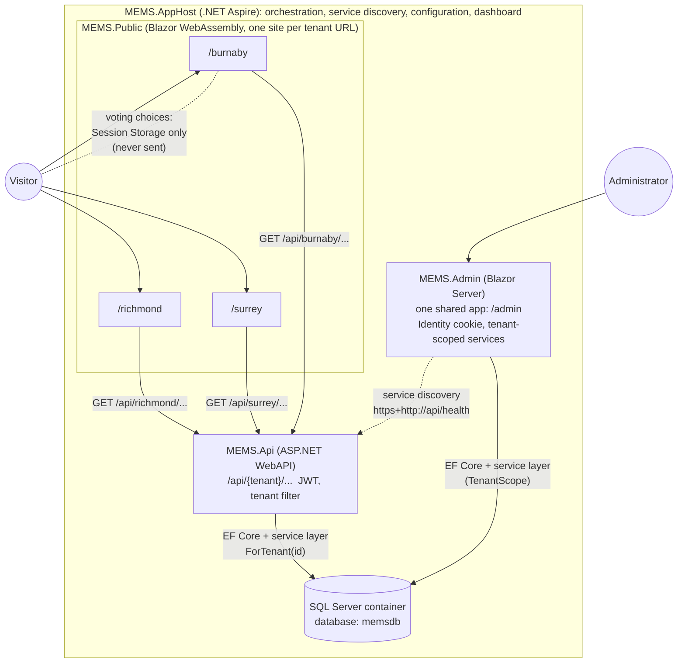
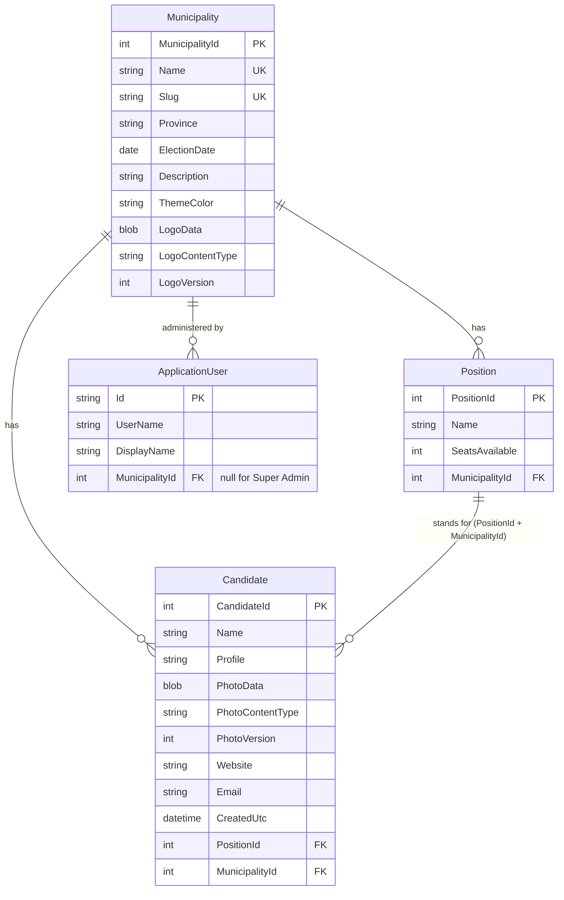

# System architecture

## Tenant isolation, layer by layer

| Layer | Mechanism |
|---|---|
| URL | `/burnaby` -> Blazor `TenantShell` loads only `GET /api/burnaby/municipality`; every child page asks for `/api/burnaby/...` |
| API | `TenantResolutionFilter` resolves `{tenant}` (unknown -> 404) and returns 403 when a signed-in Municipality Admin asks for another tenant |
| Service layer | every call takes the tenant id and a `TenantScope`; writes check `scope.CanManage(tenantId)`; queries use `ForTenant(id)` |
| EF Core / SQL | `Candidate (PositionId, MunicipalityId)` is a composite foreign key to `Position`, so a candidate cannot reference another tenant's position; unique indexes on slug and (tenant, position name) |
| Admin app | the active tenant of a Municipality Admin is fixed to the `mems:municipality_id` claim in the cookie; Super Admin chooses from a menu; `/media` image endpoints re-check the scope |

## Entity relationship diagram

Roles: `Super Admin` (no tenant) and `Municipality Admin` (exactly one tenant). Ballot selections have no table: the
database cannot store them.
