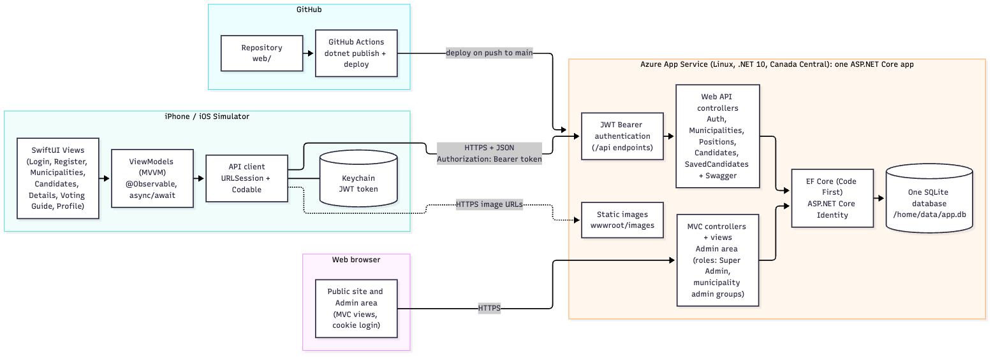
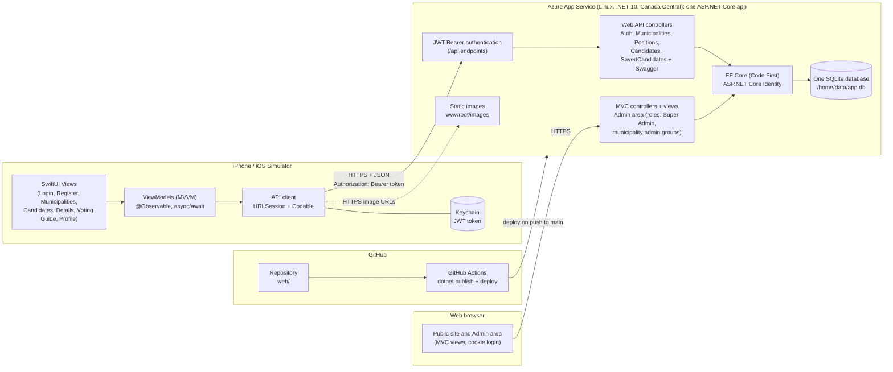

# Diagrams

The diagrams are Mermaid (`erd.mmd`, `architecture.mmd`); the PNG files are the exported
images for the project document. GitHub renders the blocks below directly.

## Database ERD

See [erd.md](erd.md) (merged schema for the MVC site and the Web API).

## Architecture

The administrators use the MVC site in a browser (cookie login). The iOS app calls the REST API of the same
app over HTTPS: login returns a JWT that the app keeps in the Keychain and sends as a Bearer token for the
voting-guide endpoints. Both parts use the same EF Core model and one SQLite database, and the app also serves
the candidate and logo images. Pushes to `main` that change `web/` are built and deployed by GitHub Actions.

Re-export the PNGs after editing a `.mmd` file (needs Node and Chrome):
`npx @mermaid-js/mermaid-cli -i architecture.mmd -o architecture.png -s 2 -b white`
