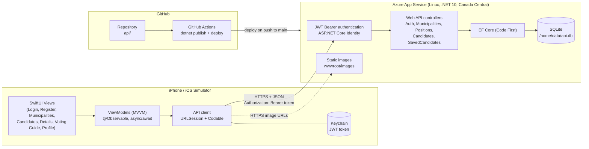

# Diagrams

The diagrams are Mermaid (`erd.mmd`, `architecture.mmd`); the PNG files are the exported
images for the project document. GitHub renders the blocks below directly.

## Database ERD

See [erd.md](erd.md) (merged schema for the MVC site and the Web API).

## Architecture

The iOS app (left) calls the REST API over HTTPS. Login returns a JWT that the app keeps in
the Keychain and sends as a Bearer token for the voting-guide endpoints. The API
(right) reads and writes SQLite through EF Core and serves the candidate and logo images.
Pushes to `main` that change `api/` are built and deployed by GitHub Actions.

Re-export the PNGs after editing a `.mmd` file (needs Node and Chrome):
`npx @mermaid-js/mermaid-cli -i erd.mmd -o erd.png -s 2 -b white`
