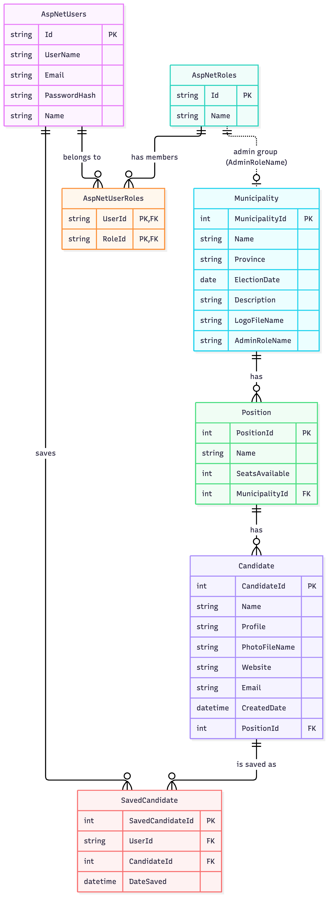

# Database ERD (merged schema for the MVC site and the Web API)

One SQLite database is shared by the ASP.NET Core MVC site (COMP4976) and the Web API used by the
iOS app (COMP4977). Source: `erd.mmd` (Mermaid), exported image: `erd.png`.

## Tables

| Table | Purpose |
|---|---|
| `AspNetUsers` | ASP.NET Core Identity users: the seeded admins (`super`, `pm`) and people who register in the iOS app. Extended with `Name`. |
| `AspNetRoles`, `AspNetUserRoles` | Identity roles ("groups") and their members: `Super Admin` and one admin group per municipality (for example `Pitt Meadows Admin`). |
| `Municipality` | A municipality that holds an election. `LogoFileName` is the uploaded logo. `AdminRoleName` is the name of its admin group. |
| `Position` | An elected position (Mayor, Councillor, School Trustee) with its number of seats, for one municipality. |
| `Candidate` | A candidate for one position. `PhotoFileName` is the uploaded photo. The municipality is reached through the position. |
| `SavedCandidate` | A candidate a logged-in user added to their voting guide (iOS app). |

## Relationships and rules

- Municipality 1 - * Position 1 - * Candidate. Deleting a municipality removes its positions and
  candidates; deleting a position removes its candidates.
- `AspNetUsers` 1 - * `SavedCandidate` * - 1 `Candidate`. `(UserId, CandidateId)` is unique, so a candidate
  can be saved only once per user.
- **Admin groups:** each municipality has an admin group (an Identity role) named in
  `Municipality.AdminRoleName` (dotted line in the diagram; a match by name, not a foreign key).
  A user in `Super Admin` can manage everything; a user in a municipality's admin group can manage the
  positions and candidates of that municipality only. Creating a municipality creates its group.
- Database table names are plural (`Municipalities`, `Positions`, `Candidates`, `SavedCandidates`); the diagram uses
  the entity names from the assignment.
- `Candidate` has no `MunicipalityId`: it is derived from the position, so the two can never disagree.
  The API still returns `municipalityId` and `municipalityName` for each candidate.

## API field mapping (iOS app)

The Web API returns the JSON that the iOS app expects, built from these columns:

| JSON field | Source |
|---|---|
| `biography` | `Candidate.Profile` |
| `photoUrl` | absolute URL of `Candidate.PhotoFileName` |
| `logoUrl` | absolute URL of `Municipality.LogoFileName` |
| `municipalityId`, `municipalityName` | `Position.Municipality` |

## Changes from the first draft

| First draft | Now | Why |
|---|---|---|
| Custom `User` table with `Password` and `Role` columns | `AspNetUsers`, `AspNetRoles`, `AspNetUserRoles` | The assignment requires ASP.NET Core Identity; it stores a password hash and roles in separate tables, and the key is a string. |
| `MunicipalityAdmin` join table | `Municipality.AdminRoleName` + one Identity role per municipality | The assignment asks for a "Super Admin group" and municipality admin groups (seeded: "Pitt Meadows Admin"). |
| No foreign key markers | `PK` / `FK` shown on every key | Easier to read and check against the migration. |
| `Candidate` without a date | `CreatedDate` added | "Date Created" is listed in the candidate information. |
| - | `SavedCandidate` added | Needed for the iOS voting guide (stored per user). |
